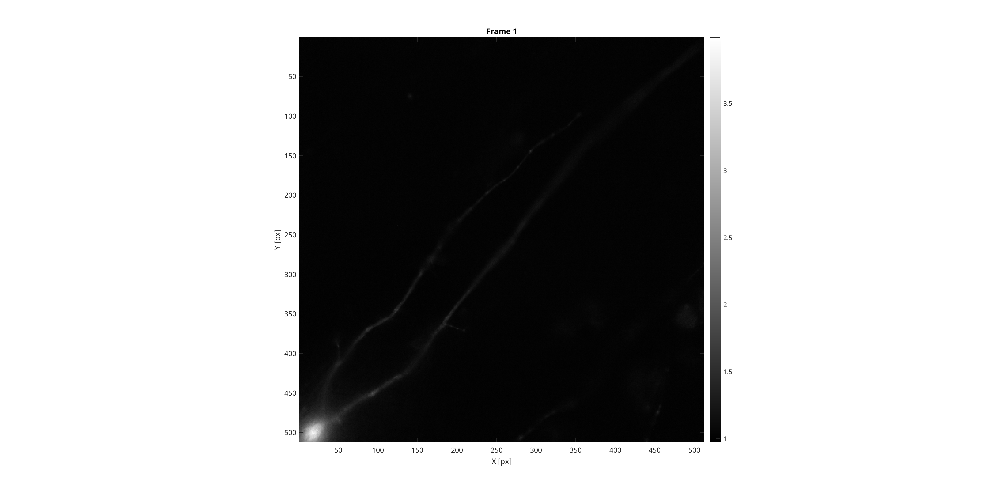
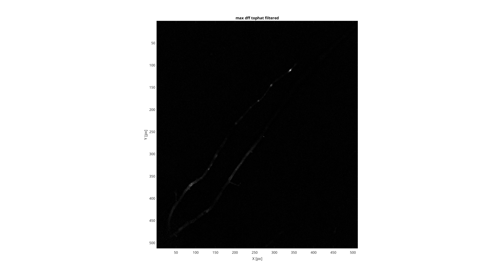
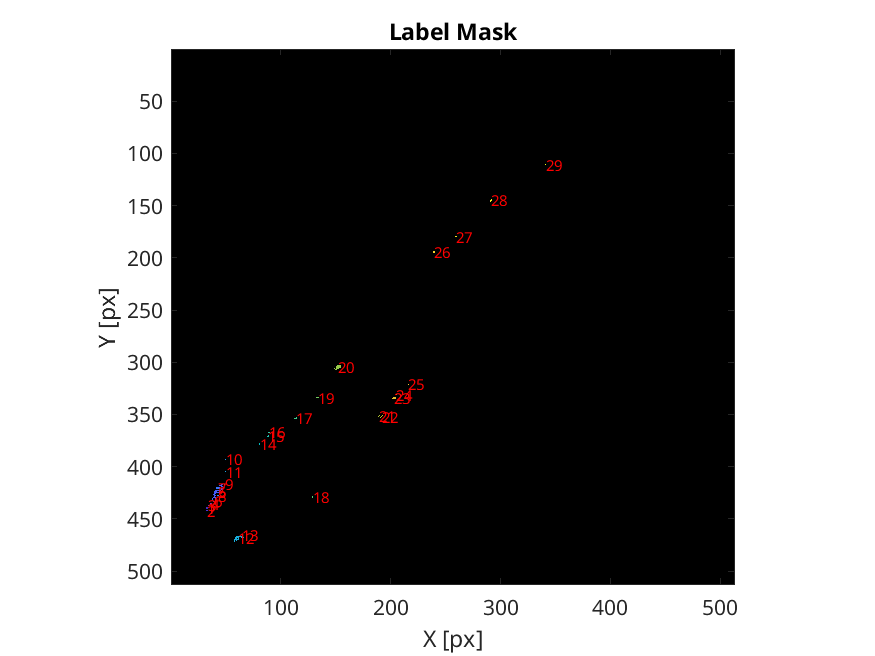
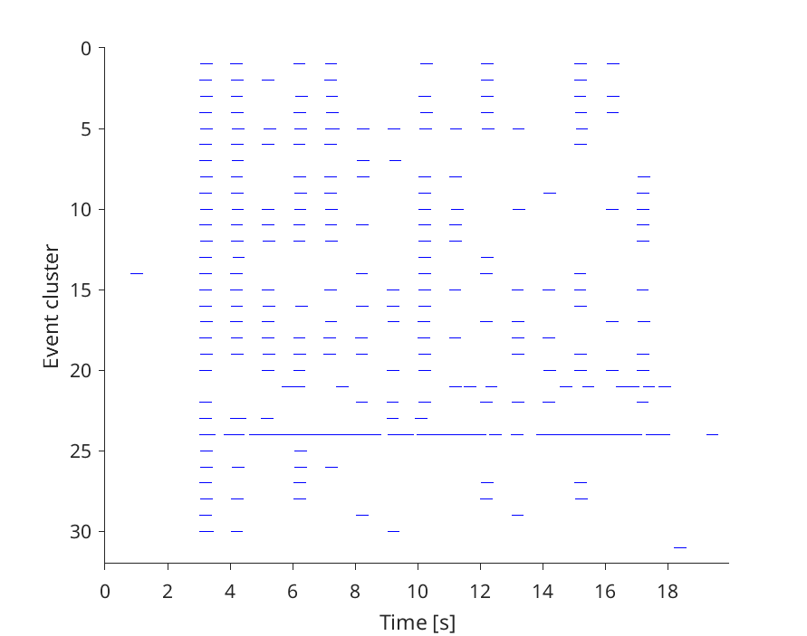
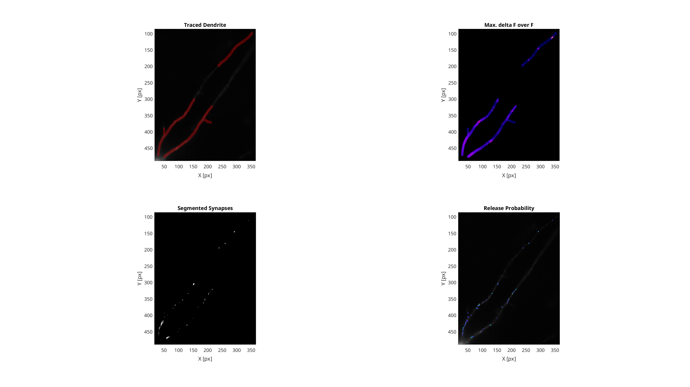

# iGluSNFR3 analysis pipeline

MATLAB pipeline for detecting and analysing synaptic activity in single-plane widefield microscopy recordings acquired with the iGluSNFR3 probe. The current entry point in this repository is `multi_cell_activity_detection_pipeline_evoked_matching.m`, which is configured for evoked responses and can match event clusters across recordings.

The pipeline accepts Bio-Formats-compatible image files. The supplied demo uses `.cxd` files and binary masks.

### Key terms

- **Region of interest (ROI):** A spatially connected group of detected pixels in the mask. The pipeline uses 8-connectivity to define ROIs, then applies the configured area limits. An ROI is an analysis region and is not necessarily a confirmed synapse.
- **Event cluster:** A spatial grouping of detected activity peaks within an ROI. The pipeline tracks the locations and frame times of those peaks; during refinement, nearby clusters may be merged when their activity timing matches within the configured criteria. An event cluster is a computational grouping, not necessarily a distinct anatomical structure.

## Table of contents
- [Key terms](#key-terms)
- [System requirements](#1-system-requirements)
  - [Operating system](#operating-system)
  - [Software](#software)
  - [Hardware](#hardware)
  - [Tested configuration](#tested-configuration)
- [Installation guide](#2-installation-guide)
- [Demo](#3-demo)
  - [Instructions to run the demo](#instructions-to-run-the-demo)
  - [Expected output](#expected-output)
- [Instructions for use](#4-instructions-for-use)
  - [Run the pipeline on new data](#run-the-pipeline-on-new-data)
  - [Output data for downstream analysis](#output-data-for-downstream-analysis)
  - [Troubleshooting](#troubleshooting)

## 1. System requirements

### Operating system

- Supported operating system: Windows, Linux, macOS
- Operating system version used for testing: **Windows 11 Pro 25H2**

The repository has not yet recorded a verified cross-platform compatibility matrix. The pipeline uses MATLAB graphics, Java-based Bio-Formats, and parallel processing, so these components must be available on the selected operating system.

### Software

- **MATLAB**: R2024b
- **Image Processing Toolbox**: required for `strel`, `imtophat`, `regionprops`, `bwlabel`, `imextendedmax`, and related image operations.
- **Signal Processing Toolbox**: required for functions such as `findpeaks` and signal-processing utilities.
- **Statistics and Machine Learning Toolbox**: required for `pdist2`, `linkage`, `cluster`, and related clustering functions.
- **Parallel Computing Toolbox**: required for the `parfor` pixel-analysis loop. (Optional but highly recommended as it significantly reduce computation time. If parallel computation is not available, change the`parfor` in the main script to `for`)
- **MATLAB Support for OpenJDK**: required by Bio-Formats. (Can be installed through MATLAB `Add-Ons` in the `Home` tab.)
- Bio-Formats MATLAB toolbox: included in `Scripts/bfmatlab/`. The source   documentation referenced by the code is [Bio-Formats MATLAB documentation](https://bio-formats.readthedocs.io/en/v7.0.0/users/matlab/index.html). Bundled/tested Bio-Formats version: v7.0.0
- [MLspike](https://github.com/MLspike/spikes): included in `Scripts/MLspike/`. The pipeline calls `tps_mlspikes` while initialising spike-train parameters, even when `ops.ST.option` is set to `"findpeaks"`. Bundled/tested MLspike version: commit 32fb84e Apr 9, 2020

The required MATLAB functions are included in this repository unless listed as part of a MATLAB toolbox above. No Python installation is required.

### Hardware

- No special hardware is required to run the analysis on existing files.
- Recommended CPU, RAM, and storage for the supplied recordings: see [Tested configuration](#tested-configuration)

### Tested configuration

- MATLAB release: 26.2.0.3386108 (R2026b)
- MATLAB toolbox versions: Version 26.2 (R2026b)
- Bio-Formats version: v7.0.0
- MLspike version or commit: 32fb84e Apr 9, 2020
- Operating system and version: Windows 11 Pro 25H2
- CPU: 12th Gen Intel(R) Core(TM) i9-12900H (2.50 GHz)
- GPU: Intel(R) Iris(R) Xe Graphics (128 MB) (Note: GPU is not a runtime requirement.)
- RAM: 32 GiB RAM
- **Runtime on demo data: 2 minutes** (130 seconds)

## 2. Installation guide

1. Get the repository from [GitHub](https://github.com/f-hamidlab/iGluSNFR3) using either method:

- **Clone with Git:**

  ```matlab
  url = "https://github.com/f-hamidlab/iGluSNFR3.git";
  branch = "publication_branch";
  repo = gitclone(url,RecurseSubmodules=1, Branch=branch)
  ```
- **Download without Git:** On the GitHub repository page, go to the `publication_branch`, select **Code** > **Download ZIP**, then extract the ZIP file.

  Open the resulting `iGluSNFR3` directory in MATLAB.

2. Confirm that the required MATLAB toolboxes listed above are installed:

```matlab
   ver
```

   You would see an output similar to the following:

```matlab
   ---------------------------------------------------------------------
   MATLAB Version: 26.2.0.3386108 (R2026b)
   MATLAB License Number: 860095
   Operating System: Microsoft Windows 11 Pro Version 10.0 (Build 26200)
   Java Version: Java is not loaded
   ---------------------------------------------------------------------
   MATLAB                                                Version 26.2        (R2026b)
   Image Processing Toolbox                              Version 26.2        (R2026b)
   MATLAB Copilot                                        Version 26.2        (R2026b)
   Parallel Computing Toolbox                            Version 26.2        (R2026b)
   Signal Processing Toolbox                             Version 26.2        (R2026b)
   Statistics and Machine Learning Toolbox               Version 26.2        (R2026b)
```

   If you don't have the required toolbox, you can follow the instructions [here](https://www.mathworks.com/help/matlab/matlab_env/get-add-ons.html) to install them.

No package manager or compilation step is required for the bundled MATLAB scripts. Installation time on a normal desktop computer: N/A, excluding download time.

## 3. Demo

The demo dataset can be downloaded from Zenodo: **[ADD DATASET LINK]**.
The dataset includes three `.cxd` demo recordings in `Test_data/originals/` and corresponding processed results in `Test_data/outputs/`. The supplied recordings are `Cell1_1.cxd`, `Cell1_2.cxd`, and `Cell1_3.cxd`. The binary mask used by the pipeline is `MAX_Cell1_1_binary_dil3.tif` in the same directory.

Recording and mask image properties:

| Recording       | Image dimensions (pixels) | Frames | Bit depth | Frame rate (Hz) | Duration (s) |
| --------------- | ------------------------- | ------ | --------- | --------------- | ------------ |
| `Cell1_1.cxd` | 512x512                   | 2000   | 16-bit    | 100             | 20           |
| `Cell1_2.cxd` | 512x512                   | 2000   | 16-bit    | 100             | 20           |
| `Cell1_3.cxd` | 512x512                   | 2000   | 16-bit    | 100             | 20           |

\* Note: The publication branch can only handle one configuration of stimulation for all recordings. If you have different configurations for different recordings, use the main branch.

| Mask file                       | Image dimensions (pixels) | Bit depth | Pixel values |
| ------------------------------- | ------------------------- | --------- | ------------ |
| `MAX_Cell1_1_binary_dil3.tif` | 512x512                   | 8-bit     | 0 and 255    |

### Instructions to run the demo

1. Start MATLAB and change directory to the repository root.
2. Open `multi_cell_activity_detection_pipeline_evoked_matching.m`.
3. In the **Defining parameters and file paths** section, set:

   ```matlab
   % ========== FILE PATHS ==========
   % path to data ; The script will loop through all subfolders.
   scriptDir = fileparts(mfilename('fullpath')); % no need to change
   ops.filedir = fullfile(scriptDir, 'Test_data', 'originals'); % path to data folder (change to where the demo data is saved)
   ops.fileformat = '.cxd';

   % path to saving directory
   ops.savedir = fullfile(scriptDir, 'Test_data', 'outputs'); % path to saving directory (change to where the outputs should be saved)

   % path to other required functions
   addpath(fullfile(scriptDir, 'Scripts'))
   addpath(fullfile(scriptDir, 'Scripts/bfmatlab/'))
   addpath(fullfile(scriptDir, 'Scripts/MLspike/brick/'))
   addpath(fullfile(scriptDir, 'Scripts/MLspike/spikes/'))
   ```
4. Run the script. It recursively processes the `.cxd` files, applies the binary masks, detects evoked events, refines nearby clusters, calculates event statistics, creates raster plots, and saves the results.

If `processed_data.mat` already exists in an output directory, the script skips that recording because `ops.redo_detection` defaults to `false`. Set `ops.redo_detection = true` to regenerate existing results.

### Expected output

Each recording is saved in its own directory under `Test_data/outputs/`, with files including:

- `processed_data.mat`: processed pixel, ROI, event-cluster, parameter, and
  statistics data.
- `denoised_im.tif`, `ImJFig1_Max_dFoF_TopHatFiltered.tif`, and
  `ImJFig2_PxMask.tif`: intermediate image products.
- `Fig1_FirstFrame.png` through `Fig7_LabelMask.png`: preprocessing,
  screening, masking, and ROI figures.
- `Fig8_SynchroniousSynapses.png`, `Fig9_StimulationResponse.png`, and
  `rasterplot.png`: event-analysis figures where generated.
- `ROI_pxMap/` and `ROI_px/`: ROI maps and pixel-level plots where generated. Since saving figures takes time, by default, these are not plotted. If needed, set:
  ```matlab
  ops.plot_pxMap = true;                     % Plot pixel map for each ROI (memory intensive)
  ops.plot_ROI_overall_signal = true;        % Plot averaged signal per ROI (memory intensive)
  ops.plot_ROI_px_signal = true;             % Plot individual pixel signals per ROI (slow)
  ```

Results of matching synapses across recordings includes:

- `ClusterMatchingFig1_Distribution`, `ClusterMatchingFig2_Histogram`, and `ClusterMatchingFig3_Overall`: matching figures generated by `matching_clusters` after all recordings in the output tree have been
  processed.
- `results.mat`: containing the matched cluster summaries and combined event-cluster data. Figures are saved in both MATLAB `.fig` format and the configured image format.

**Representative outputs have been included in the repository:**


**Fig. 1** *The first frame of the time stack.*


**Fig. 2** *The maximum delta F over F after tophat filter for background removal.*


**Fig. 3** *Segmented regions of interest (probably synapses) with region ID.*


**Fig. 4** *Raster plot of the event clusters.*


**Fig. 5** *(Top left) Traced dendrite overlaid on first frame of time stack. (Top right) Maximum delta F over F across recordings. (Bottom left) Segmented region of interests / synapses. (Bottom right) release probability  for each synapes.*

The exact number of detected pixels, ROIs, events, and clusters depends on the parameter settings. Expected demo counts and summary values:
| Recording       | No. of ROIs | No. of evert clusters | Total no. of spikes |
| --------------- | ----------- | --------------------- | ------------------- |
| `Cell1_1.cxd`   | 29          | 31                    | 284                 |
| `Cell1_2.cxd`   | 32          | 30                    | 213                 |
| `Cell1_3.cxd`   | 17          | 17                    | 112                 |

The demo outputs are included in the repository.

Expected demo run time on a normal desktop computer: see [Tested configuration](#tested-configuration)

## 4. Instructions for use

***It is highly recommended to use the main branch, which is ahead of this publication branch and has more functionalities and flexibility for new datasets.***

### Run the pipeline on new data

1. Prepare one or more single-plane time-series recordings in a Bio-Formats-compatible format, such as `.cxd` or `.tif`.
2. For each recording processed with `ops.use_binary_mask = true`, place a binary mask in the same directory as the recording. The current script searches for a file matching:

   ```text
   MAX_Cell*_binary_*.tif
   ```

   The mask must have the same image dimensions as the recording. Set `ops.use_binary_mask = false` only when automatic thresholding is intended.
3. Copy the pipeline script or create a working copy, then edit the **Defining parameters and file paths** section:

   ```matlab
   ops.filedir = 'PATH_TO_INPUT_FOLDER';
   ops.fileformat = '.cxd';       % Change to '.tif' or another supported format
   ops.savedir = 'PATH_TO_OUTPUT_FOLDER';
   ```
4. Set the experiment and acquisition parameters to match the recording:

   ```matlab
   ops.experiment_type = "evoked"; % or "spontaneous"
   ops.first_stim = 3;              % seconds
   ops.n_stim = 15;
   ops.stim_freq = 1;               % Hz
   ops.fs = 100;                    % frames/second
   ```

   For spontaneous recordings, set `ops.experiment_type = "spontaneous"`.
   The evoked-only stimulus parameters are then unused.
5. Review preprocessing, mask, slope/SNR, baseline-drift, ROI-area, event, clustering, and spike-train settings in the same section. In particular, set `ops.redo_detection = true` when rerunning an existing output folder.
6. Run the script. The script creates output directories automatically and writes `processed_data.mat`,  `results.mat`, plus diagnostic figures.

### Output data for downstream analysis

Load the main result with:

```matlab
result = load(fullfile('PATH_TO_OUTPUT_FOLDER', 'RECORDING_NAME', ...
		'processed_data.mat'));
```

Depending on the run, the MAT-file contains `px`, `mask`, `ind`, `ops`, raw and
processed signals, `event_cluster`, `ROI`, and `stats`. The helper scripts
`event_stats.m`, `ROI_pxMap_allTime.m`, `show_label_mask.m`,
`show_label_mask_with_text.m`, `add_event.m`, `remove_event.m`, and
`remove_ROI.m` support analysis and manual curation of saved results.

For matching clusters across recordings, the pipeline calls
`matching_clusters(ops.savepath)` after processing a directory tree. This
expects multiple compatible `processed_data.mat` files and writes matching
figures and `results.mat` at the specified output root.

### Troubleshooting

- **`bfopen` or Java errors:** verify the `Scripts/bfmatlab/` path and the Bio-Formats Java configuration.
- **`tps_mlspikes` not found:** verify that `Scripts/MLspike/` is on the MATLAB path, including its subdirectories.
- **No mask found:** check that the mask is beside the input recording and its filename matches `MAX_Cell*_binary_*.tif`, or disable binary-mask use.
- **Existing data is skipped:** set `ops.redo_detection = true`.
- **Out-of-memory or slow processing:** process fewer recordings at once, reduce the image/time-series size, or record the available-memory guidance here: **[FILL IN]**.

## 5. License

This repository is licensed under the GNU General Public License v3.0 (GPL-3.0).
 
This repository contains and distributes Bio-Formats, which is licensed under the GPL. See the included license files and the Bio-Formats documentation for details.

The dataset archived on Zenodo is licensed under CC BY 4.0. 

Please cite the dataset and acknowledge the authors when reusing the data.
